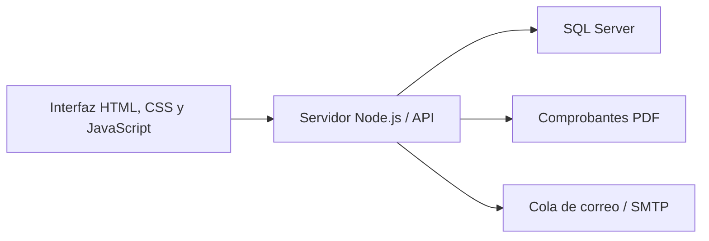

<div align="center">


# Sistema de facturación

**Gestión de clientes, productos y comprobantes con IVA incluido y comisiones por vendedor.**


[Características](#características) · [Instalación](#instalación) · [Pruebas](#pruebas) · [Documentación](#documentación)

</div>

Aplicación desarrollada para la asignatura de Desarrollo de Aplicaciones Web (DAW). La interfaz utiliza HTML, CSS y JavaScript modular; Node.js sirve la aplicación y la API, y SQL Server almacena los datos. Incluye comprobantes de consumidor final (CF), crédito fiscal (CCF), descarga de PDF y envío por SMTP.

> **Uso académico:** los comprobantes muestran «Documento de prueba - sin validez fiscal». La aplicación no implementa firma ni transmisión de documentos tributarios electrónicos a Hacienda.

## Características

| Área | Funcionalidades |
| --- | --- |
| Facturación | CF y CCF, historial, PDF, reenvío y anulación por administrador |
| Catálogos | Clientes, sucursales y productos gravados, exentos y no sujetos |
| Cálculos | IVA incluido, descuentos y comisiones por línea sin IVA |
| Usuarios | Roles de administrador y facturador, correos editables, horarios y permiso remoto |
| Acceso | Festivos, vacaciones, bloqueos, redes de oficina y país permitido |
| Seguridad | Contraseñas con scrypt, sesiones en servidor, protección CSRF y auditoría |
| Correo | PDF adjunto, cola persistente, reintentos y alertas de acceso |

Los comprobantes conservan copias históricas de emisor, receptor y productos. El servidor genera los correlativos y reconoce solicitudes de emisión repetidas para evitar facturas duplicadas. Cada facturador consulta sus documentos; el administrador puede consultar todos.

## Tecnologías y arquitectura



| Componente | Tecnología |
| --- | --- |
| Interfaz y vista previa | HTML, CSS y JavaScript con módulos ES |
| Servidor HTTP y pruebas | Módulos nativos de Node.js |
| Base de datos | SQL Server, `mssql` y `msnodesqlv8` |
| PDF | `pdfkit` |
| Correo | `nodemailer` |
| Ubicación por país | `maxmind` y base local `.mmdb` |

Las clases de cálculo de la interfaz demuestran herencia y polimorfismo mediante el contrato `calcular()`. El servidor valida los importes usando los precios del catálogo antes de guardar.

## Instalación

### Despliegue en servidor con Docker

Se incluyen `Dockerfile`, `compose.yaml` y un proxy Caddy con HTTPS automático. La aplicación corre sin privilegios y se conecta a un **SQL Server externo mediante autenticación SQL**.

Copia `.env.docker.example` a `.env.docker`, completa dominio, conexión SQL, correo y redes de oficina, y sigue la [guía de despliegue Docker](deploy/DOCKER.md) para construir la imagen, preparar la base y arrancar los servicios. La guía incluye comprobaciones, migraciones, respaldos y actualizaciones.

### Acceso rápido desde PowerShell o Visual Studio Code

En una instalación que ya tiene dependencias, `.env` y base de datos configurados, abre la terminal en la carpeta del proyecto:

```powershell
npm.cmd run acceso
npm.cmd start
```

`acceso` muestra todos los usuarios existentes con su rol y estado. Escribe el usuario que quieres usar (Enter selecciona `admin`). Si existe, escribe `CAMBIAR` para restablecer su contraseña; si no existe, el asistente permite elegir entre administrador y facturador. Al restablecer una cuenta existente se conserva su rol. Puedes escribir una contraseña de 12 a 200 caracteres —no se muestra mientras la escribes— o pulsar Enter para generar una, que se muestra una sola vez. Cancelar no cambia las credenciales. El comando no requiere buscar ni editar la contraseña en `.env`.

Abre la dirección que muestra el servidor y conserva la terminal abierta. **Ctrl + C** detiene el servidor. Estos comandos funcionan sin instalar pnpm si las dependencias ya están instaladas. `npm.cmd` evita el bloqueo de scripts de PowerShell que puede afectar a `npm.ps1`.

El restablecimiento cierra las sesiones de esa cuenta y conserva sus permisos y bloqueos. También puedes gestionar las contraseñas desde **Administración → Usuarios → Usuarios y permisos → Editar** y asigna una nueva contraseña. Las claves se guardan como hashes y no se pueden recuperar como texto; el comando local permite reemplazarlas.

En un servidor nuevo, configura la conexión SQL en `.env`, instala las dependencias y ejecuta `npm.cmd run db:install`, luego `npm.cmd run acceso` y `npm.cmd start`. Si la base ya existe, utiliza `npm.cmd run db:migrate` en lugar de `db:install`. El asistente se ejecuta en la consola del servidor; no es una página pública para restablecer contraseñas.

### Requisitos

- Node.js 22 o posterior y pnpm.
- SQL Server 2019 o posterior.
- Para autenticación de Windows: Microsoft ODBC Driver 18 for SQL Server y acceso a la instancia para la cuenta que ejecuta Node.js.
- Un servidor SMTP para enviar correos.

### 1. Clonar e instalar

```powershell
git clone https://github.com/caleb-bvm/DAW-Sistema-de-Facturaci-n.git
cd DAW-Sistema-de-Facturaci-n
pnpm install --frozen-lockfile
Copy-Item .env.example .env
```

Los ejemplos de instalación utilizan PowerShell. En otra terminal, copiar `.env.example` a `.env` con el comando correspondiente. `pnpm-workspace.yaml` permite compilar la dependencia nativa `msnodesqlv8`; autorizar su compilación si pnpm lo solicita.

### 2. Configurar el entorno

Editar `.env` con los datos de la instalación:

| Variable | Valor o uso |
| --- | --- |
| `APP_ENV` | `development` para desarrollo local |
| `APP_ORIGIN` | `http://localhost:3000` para desarrollo local |
| `APP_BASE_PATH` | `/facturacion`; dejar vacío para servir desde `/` |
| `DB_AUTH` | `windows` o `sql` |
| `DB_HOST` | Dirección de SQL Server; la plantilla usa `localhost` |
| `DB_INSTANCE` | `SQLEXPRESS` en la plantilla; vacío si se usa un puerto fijo |
| `DB_PORT` | Puerto TCP cuando no se configura una instancia con nombre |
| `DB_NAME` | `facturacion_db` o el nombre elegido |
| `DB_USER`, `DB_PASS` | Credenciales para `DB_AUTH=sql` |
| `BOOTSTRAP_ADMIN_PASSWORD` | Contraseña propia de entre 12 y 200 caracteres |

La plantilla usa `DB_TRUST_CERTIFICATE=true` para certificados autofirmados en desarrollo. En producción, utilizar un certificado válido y configurar `false`.

### 3. Preparar la base e iniciar

Para una base nueva o vacía:

```powershell
pnpm db:install
pnpm setup
pnpm start
```

Abrir **[http://localhost:3000/facturacion/](http://localhost:3000/facturacion/)** e ingresar con el usuario `admin` y la contraseña configurada en `BOOTSTRAP_ADMIN_PASSWORD`. Si `APP_BASE_PATH` está vacío, abrir [http://localhost:3000/](http://localhost:3000/).

`db:install` crea la base si hace falta y aplica el esquema y todas las migraciones. Requiere permisos para crear la base y su estructura, y rechaza bases que ya tengan tablas. `setup` crea `admin` sólo si no existe; repetir el comando no restablece su contraseña.

Los vendedores de demostración empiezan inactivos y sin contraseña utilizable. Desde la administración se les asigna contraseña, se activan y se configuran sus horarios. Se incluyen productos y sucursales de demostración.

<details>
<summary><strong>Migrar una base SQL Server existente</strong></summary>

Realizar un respaldo y configurar la conexión a una base con la estructura inicial del proyecto:

```powershell
pnpm db:migrate
pnpm setup
```

La migración es transaccional y se registra en `schema_migrations` para evitar repeticiones. `setup` protege contraseñas iniciales con scrypt y rechaza hashes PHP existentes que requieren restablecimiento. Los archivos de `database/` usan T-SQL; los datos de una base MySQL deben exportarse y trasladarse explícitamente.

</details>

## Docker

La opción más rápida para ejecutar el proyecto completo (app + SQL Server 2022) con sólo Docker y Docker Compose. La pila reutiliza el mismo [.env](.env.example): dentro del contenedor sólo se fuerzan `DB_AUTH=sql` y `DB_HOST=db`, porque la autenticación de Windows (`msnodesqlv8`/ODBC) no está disponible en Linux. El SMTP, `COMPANY_*` y el resto de variables se aplican tal cual.

### Arranque de desarrollo

1. Preparar el entorno (PowerShell: `Copy-Item .env.example .env`) y definir en `.env`:

   | Variable | Uso |
   | --- | --- |
   | `BOOTSTRAP_ADMIN_PASSWORD` | Contraseña del `admin`, de 12 a 200 caracteres (ya obligatoria para `pnpm setup`) |
   | `MSSQL_SA_PASSWORD` | Contraseña del `sa` del contenedor SQL Server; 8+ caracteres con mayúsculas, minúsculas y números. Distinta de `DB_PASS` |
   | `DB_PASS` | Contraseña del login de la aplicación (`DB_USER`). En el primer arranque el contenedor la crea automáticamente con esa contraseña |

2. Levantar la pila:

   ```bash
   docker compose up --build
   ```

   En el primer arranque el contenedor espera a SQL Server, crea el login `DB_USER` con `MSSQL_SA_PASSWORD` (la app nunca ve la cuenta `sa`), crea la base y aplica el esquema (equivale a `pnpm db:install`) y crea el `admin` (equivale a `pnpm setup`). Repetir el comando es inocuo: el login se ajusta a `DB_PASS`, la instalación se omite si la base ya tiene tablas y el admin existente no se sobrescribe.

Abrir **[http://localhost:3000/facturacion/](http://localhost:3000/facturacion/)** e ingresar con `admin` y `BOOTSTRAP_ADMIN_PASSWORD`. Los datos persisten en el volumen `mssql-data`; el puerto de la app es `3000` (`APP_PORT` lo cambia) y SQL Server queda sólo en la red interna.

> **Acceso y ubicación:** en contenedor las peticiones llegan desde la red de Docker, no desde `localhost`, y el sistema rechaza las ubicaciones desconocidas. Por eso compose usa `OFFICE_NETWORKS=172.31.31.0/24` (la red interna de la pila) mientras `.env` no defina otras redes. En un despliegue real, define en `.env` las redes de oficina reales junto con GeoIP.

### Entorno productivo (proxy TLS)

```bash
docker compose -f docker-compose.yml -f docker-compose.prod.yml up -d --build
```

La segunda plantilla ([docker-compose.prod.yml](docker-compose.prod.yml)) convierte el mismo servicio `app` en modo producción (`APP_ENV=production`), deja de publicar su puerto y añade un proxy nginx con TLS, siguiendo el modelo de [deploy/nginx-facturacion.conf](deploy/nginx-facturacion.conf). Comparte red y base de datos con el perfil dev:

- La primera vez, `tls-init` genera un certificado autofirmado en el volumen `tls-certs`. Para usar certificados propios, colocar `fullchain.pem` y `privkey.pem` en ese volumen.
- `APP_ORIGIN` debe coincidir exactamente con el origen que muestra el navegador, esquema y puerto incluidos: `https://localhost:8443` para probar en local. Si no coincide, el API responde `403 Origen no autorizado`.
- Abrir **[https://localhost:8443/facturacion/](https://localhost:8443/facturacion/)** y aceptar el aviso del certificado autofirmado. El puerto es `HTTPS_PORT` (por defecto 8443).
- `TRUSTED_PROXIES` lo fija la plantilla a la IP fija del proxy (`172.31.31.20`); el servidor sólo acepta la cabecera `X-Forwarded-Proto` desde esa IP.

### Comandos con Docker

| Comando | Descripción |
| --- | --- |
| `docker compose exec app pnpm test` | Ejecuta las pruebas locales dentro del contenedor |
| `docker compose logs -f app` | Sigue los registros de la app |
| `docker compose exec app node --env-file=.env scripts/verify-smtp.js` | Verifica conexión y autenticación SMTP |
| `docker compose down` | Detiene la pila conservando los datos |
| `docker compose down -v` | Detiene la pila y elimina la base de datos |

## IVA y comisiones

Los precios gravados incluyen el IVA del 13 %. Por línea, el sistema calcula `precio × cantidad − descuento`, divide el resultado entre `1.13` para obtener la base y determina el IVA por diferencia. Los productos exentos y no sujetos conservan su clasificación y no extraen IVA.

| Base por línea sin IVA | Comisión |
| ---: | ---: |
| $0.00 | 0 % |
| $0.01 a $100.00 | 1 % |
| $100.01 a $1,000.00 | 2 % |
| $1,000.01 a $2,000.00 | 3 % |
| Desde $2,000.01 | 4 % |

**Ejemplo:** dos unidades a $113.00 en una línea suman $226.00: base de $200.00, IVA de $26.00 y comisión de $4.00. Dos líneas distintas con base de $100.00 cada una generan $2.00 de comisión total.

Los cálculos usan centavos enteros y redondean por línea antes de sumar. El PDF del cliente omite las comisiones. Un CCF requiere un cliente contribuyente con NIT, NRC, actividad económica, dirección y correo.

## Comandos

| Comando | Descripción |
| --- | --- |
| `pnpm start` | Inicia el servidor y el procesamiento periódico de correo |
| `pnpm db:install` | Prepara una base nueva o vacía |
| `pnpm db:migrate` | Migra una base SQL Server con la estructura inicial |
| `pnpm setup` | Protege contraseñas iniciales y crea el administrador si falta |
| `npm.cmd run acceso` | Asistente para crear usuarios y restablecer contraseñas de administradores y facturadores |
| `pnpm mail` | Procesa un lote de correos pendientes |
| `pnpm test` | Ejecuta las pruebas locales |
| `pnpm test:integration` | Ejecuta la prueba integral de SQL Server |
| `node scripts/check-js.js` | Comprueba la sintaxis de los módulos JavaScript |

## Pruebas

```powershell
pnpm test
node scripts/check-js.js
```

Las pruebas cubren cálculos, restricciones de acceso, contraseñas, parámetros SQL, sesiones HTTP, archivos privados, subrutas y PDF con paginación. Los PDF de ejemplo se generan en `test-output/`. La prueba de integración se omite si `SQL_INTEGRATION` no está habilitada.

<details>
<summary><strong>Preparar y ejecutar la prueba integral</strong></summary>

Utilizar una base exclusiva cuyo nombre termine en `_test`. La prueba crea registros y los conserva al finalizar.

```powershell
Copy-Item .env.test.example .env.test
node --env-file=.env --env-file=.env.test scripts/install.js
node --env-file=.env --env-file=.env.test scripts/setup.js
pnpm test:integration
```

Comprobar que `.env` usa `APP_ENV=development` y que `.env.test` contiene `DB_NAME=facturacion_test` y `SQL_INTEGRATION=true`. El segundo archivo reemplaza el nombre de la base. Los pasos de instalación y setup se ejecutan sólo al preparar la base de pruebas por primera vez.

La prueba comprueba autenticación, emisión CF/CCF, PDF, datos históricos, transacciones, autorización, bloqueos y anulación. Utiliza un SMTP simulado en localhost para los comprobantes generados durante la prueba.

</details>

## Configuración adicional

<details>
<summary><strong>Horarios, ubicación y acceso remoto</strong></summary>

Las restricciones se revisan en cada solicitud. Los facturadores deben respetar horarios, festivos, vacaciones y bloqueos. Los administradores están exentos de horarios y festivos; siguen sujetos a ubicación, estado de cuenta y bloqueos.

| Variable | Uso |
| --- | --- |
| `OFFICE_NETWORKS` | IP o redes CIDR de oficina, separadas por comas |
| `COUNTRY` | País permitido; la plantilla usa `SV` |
| `GEOIP_DATABASE` | Ruta a una base local MaxMind de países `.mmdb` |
| `TIMEZONE` | Zona para fechas y horarios; `America/El_Salvador` en la plantilla |
| `SESSION_MINUTES` | Duración máxima de inactividad de la sesión |

Fuera de las redes autorizadas, el acceso requiere permiso remoto por usuario y un país permitido determinado por GeoIP. Se rechazan ubicaciones desconocidas. En desarrollo, localhost permite probar sin GeoIP. Los rechazos se registran y las alertas repetidas se agrupan en ventanas de cinco minutos.

</details>

<details>
<summary><strong>Correo SMTP y diagnósticos</strong></summary>

Configurar `SMTP_HOST`, `SMTP_PORT`, `SMTP_SECURE`, `SMTP_REQUIRE_TLS`, `SMTP_USER`, `SMTP_PASSWORD` y `MAIL_FROM`. `ADMIN_EMAIL` define el destinatario inicial de alertas de acceso, hasta que se guarde uno desde Administración. Las plantillas contienen un servidor de ejemplo que debe ajustarse a la instalación. Para TLS implícito en el puerto 465, usar `SMTP_SECURE=true` y `SMTP_REQUIRE_TLS=false`.

La factura y su correo pendiente se guardan en una misma transacción. La cola se procesa cada minuto y después de emitir o reenviar. Cada correo dispone de hasta cinco intentos automáticos con espera creciente y reintento manual de fallidos. La aceptación por SMTP no confirma entrega en la bandeja del destinatario.

```powershell
# Consultar el protocolo sin autenticar ni enviar mensajes
node --env-file=.env scripts/check-smtp.js

# Verificar conexión y autenticación sin enviar mensajes
node --env-file=.env scripts/verify-smtp.js
```

Configurar SPF, DKIM y DMARC del dominio para favorecer la entrega.

</details>

<details>
<summary><strong>Despliegue con HTTPS y Nginx</strong></summary>

Para Docker con HTTPS incluido, seguir la [guía Docker](deploy/DOCKER.md) y usar [.env.docker.example](.env.docker.example). Para una instalación directa de Node detrás de Nginx, partir de [.env.example](.env.example), completar credenciales, datos `COMPANY_*`, redes autorizadas y GeoIP. Configurar `APP_ENV=production`, `APP_ORIGIN=https://tu-dominio.com` y `DB_TRUST_CERTIFICATE=false`.

`APP_ORIGIN` contiene sólo el origen; la subruta se define mediante `APP_BASE_PATH`. La plantilla utiliza `/facturacion`. El servidor redirige `/facturacion` a `/facturacion/` y limita la cookie de sesión a esa ruta.

Añadir [deploy/nginx-facturacion.conf](deploy/nginx-facturacion.conf) al bloque HTTPS de Nginx. El proxy conserva la ruta y reenvía `Host`, `X-Forwarded-For` y `X-Forwarded-Proto` a Node.js, que escucha por defecto en `127.0.0.1:3000`. Configurar la supervisión y el arranque del proceso en el servidor.

Incluir en `TRUSTED_PROXIES` sólo proxies controlados. La API de producción exige HTTPS y acepta las cabeceras reenviadas únicamente desde proxies confiables. La cuenta SQL de ejecución necesita los permisos de lectura y escritura de la aplicación; la instalación y migración requieren permisos adicionales.

</details>

## Estructura del proyecto

```text
DAW-Sistema-de-Facturaci-n/
├── assets/                   Interfaz, estilos y calculadoras
├── database/
│   ├── schema.sql            Esquema T-SQL inicial
│   └── migrations/           Migraciones de SQL Server
├── deploy/
│   ├── docker/               Configuración nginx del perfil prod Docker
│   ├── create-sql-login.js   Crea el login de la app en el SQL del contenedor
│   ├── docker-entrypoint.sh  Arranque del contenedor: login, base, setup y servidor
│   └── nginx-facturacion.conf  Configuración de Nginx
├── scripts/                  Instalación, migración y diagnósticos
├── server/                   API, acceso, cálculos, PDF y correo
├── storage/                  Archivos locales generados
├── tests/                    Pruebas locales e integración
├── .dockerignore             Exclusiones del build de imagen
├── .env.example              Plantilla de desarrollo
├── .env.docker.example       Plantilla de producción con Docker
├── Dockerfile               Imagen de la aplicación
├── compose.yaml             Aplicación y proxy HTTPS
├── .env.test.example         Plantilla de integración
├── Dockerfile                Imagen multi etapa de la aplicación
├── docker-compose.yml        Pila dev: app + SQL Server 2022
├── docker-compose.prod.yml   Combinación productiva con proxy TLS
├── index.html                Entrada de la interfaz
└── package.json              Dependencias y comandos
```

## Documentación

- [Guía de arquitectura y decisiones](Sistema%20de%20Facturacion.md).
- [Reglas de IVA incluido y comisiones](REQUISITOS-IVA-Y-COMISIONES.md).
- [Plantilla de configuración local](.env.example).
- [Configuración del proxy Nginx](deploy/nginx-facturacion.conf).


### Mejoras de captura y actividad

- Productos y clientes muestran el catálogo y abren el formulario con **Nuevo** o **Editar**. Los datos fiscales del cliente se despliegan al activar crédito fiscal.
- Nueva factura conserva el borrador al navegar a otras vistas, durante la sesión de la pestaña. Recargar o cerrar sesión lo descarta. **Vaciar borrador** permite empezar de nuevo.
- Las líneas permiten buscar productos por código o descripción, detectan duplicados y limitan el descuento al importe de la línea. En pantallas pequeñas se muestran como tarjetas.
- Administración → Actividad ofrece búsqueda, categoría, estado, fechas UTC, paginación y detalle del evento. Las horas del listado se presentan en la zona configurada. Los correos muestran su último estado, no cada intento histórico.
- La migración `003_detalle_auditoria.sql` añade contexto a las nuevas operaciones (IP, origen y datos relevantes, sin contraseñas ni tokens). Los eventos antiguos conservan sus datos originales.

### Empresa de demostración

El sistema incluye los datos ficticios de **Zona Digital**, dedicada a la venta de equipos informáticos, accesorios y servicios de soporte técnico en San Salvador, El Salvador. El NIT `0614-150326-101-3`, NRC `345678-9`, dirección y teléfono son inventados para demostración; el correo `contacto@zonadigital.example` utiliza un dominio de ejemplo. Los valores se configuran mediante `COMPANY_*` en `.env`. Reiniciar el servidor después de cambiarlos. Los comprobantes ya emitidos conservan los datos históricos del emisor.
